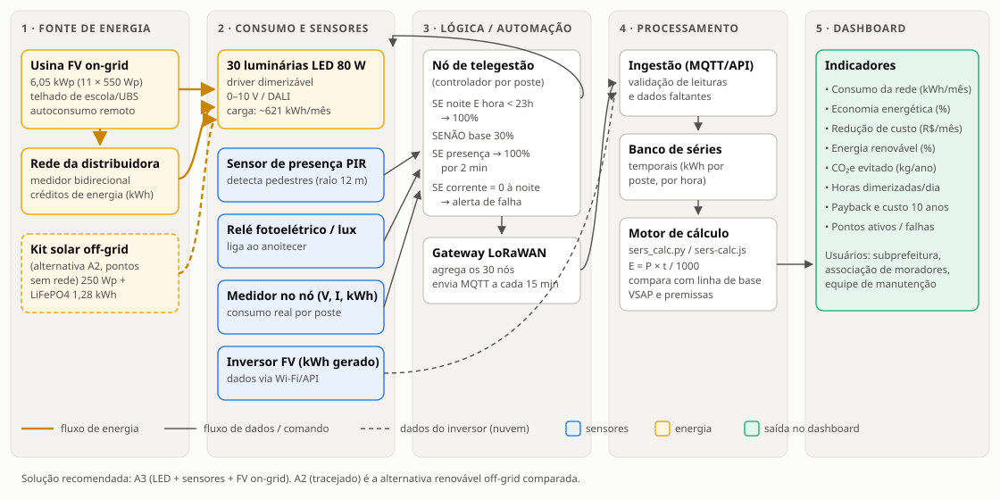
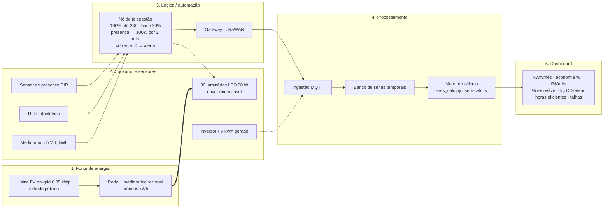

# Praça Comunitária Iluminada — Neighborhood Action Dashboard (SERS)

**Global Solution 2026.2 · Ciência da Computação (1CC) · Disciplina: Soluções em Energias Renováveis e Sustentáveis (SERS)**
**Desafio integrador:** Neighborhood Action Dashboard — CitizenTech

> Esta pasta/repositório é a **contribuição de SERS** para o Neighborhood Action Dashboard. Se o projeto integrador estiver em um repositório compartilhado, ela fica identificada na pasta `sers/` (ou neste repositório dedicado).

## Integrantes

| Nome completo | RM |
|---|---|
| _Nome do integrante 1_ | _RM00000_ |
| _Nome do integrante 2_ | _RM00000_ |
| _Nome do integrante 3_ | _RM00000_ |

**Vídeo (YouTube, não listado):** _cole o link aqui_
**Dashboard online:** https://pedroderossi.github.io/sers-neighborhood-action-dashboard/dashboard/

---

## 1. Diagnóstico do problema

| Item | Descrição |
|---|---|
| **Espaço comunitário** | Praça de bairro residencial (cenário de referência em São Paulo/SP), ~6.000 m², **30 postes** de iluminação. |
| **Problema energético** | Lâmpadas de **vapor de sódio (VSAP) 150 W** com reator eletromagnético (168 W por ponto), acesas a **100% a noite inteira**, mesmo de madrugada com a praça vazia. Luz amarelada (IRC ≈ 25), sem monitoramento: um poste queimado só é descoberto quando alguém reclama. |
| **Público beneficiado** | Moradores do entorno (crianças, idosos, praticantes de esporte), pedestres que cruzam a praça à noite, comércio local; indiretamente a prefeitura/subprefeitura, que paga a energia com a COSIP. |
| **Condições de funcionamento** | Operação do anoitecer ao amanhecer, 365 noites/ano (10,8 h em dezembro a 13,2 h em junho); maior movimento até ~23 h; exposição ao tempo e a vandalismo. |
| **Benefícios esperados** | Menos energia e custo, luz branca de melhor qualidade (sensação de segurança), detecção automática de falhas, uso de energia renovável e fim do descarte de lâmpadas com mercúrio. |

## 2. Análise do consumo energético

Fórmula usada (enunciado, item 4.2):

$$E\,[\text{kWh}] = \frac{P\,[\text{W}] \times t\,[\text{h}]}{1000}$$

Consumo mensal = nº de pontos × E diária × dias do mês. Período de referência comum: **1 ano (12 meses)**, apresentado também como média mensal.

**Situação atual (A0):** P = 150 W × (1 + 12% de perdas do reator) = **168 W/ponto**

- Exemplo junho: 30 × (168 × 13,2 / 1000) × 30 = **1.996 kWh**
- Total anual: **22.111 kWh/ano ≈ 1.843 kWh/mês** → R$ 11.056/ano em energia (tarifa R$ 0,50/kWh)

O cálculo completo, mês a mês, está em [`docs/memorial_calculo.md`](docs/memorial_calculo.md) e é reproduzido pelo script [`calculos/sers_calc.py`](calculos/sers_calc.py) (saída em [`data/resultados_mensais.csv`](data/resultados_mensais.csv)).

### Dados utilizados e fontes

Todas as premissas estão em [`data/premissas.json`](data/premissas.json), cada uma com sua fonte:

| Dado | Valor adotado | Fonte / justificativa |
|---|---|---|
| Nº de pontos | 30 postes | Cenário de referência da equipe |
| Duração da noite | 10,8 h (dez) a 13,2 h (jun), média 12,0 h | Tabelas de nascer/pôr do sol, lat. 23,5°S |
| Irradiação (HSP) no plano inclinado | 3,8 (jun) a 5,2 (fev) kWh/m²·dia | Ordem de grandeza CRESESB/SunData e Atlas Brasileiro de Energia Solar (INPE, 2017) |
| Tarifa de IP (B4a) com tributos | R$ 0,50/kWh | Ordem de grandeza ANEEL para distribuidoras de SP (ajustável no dashboard) |
| Fator de emissão do SIN | 0,0385 kg CO₂/kWh | MCTI, fator médio anual 2023 |
| VSAP 150 W + reator | 168 W, ~15.000 lm, vida 24.000 h | PROCEL Reluz; catálogos de fabricantes |
| LED 80 W | ~140 lm/W, vida 60.000 h | Portaria INMETRO 62/2022; catálogos |
| Kit solar off-grid | 250 Wp + LiFePO4 1,28 kWh + MPPT + LED 60 W: R$ 4.500 | Pesquisa de mercado (estimativa) |
| FV on-grid | R$ 3.800/kWp; PR 0,78 | Greener — Estudo Estratégico de GD (faixa R$ 3.500–4.200/kWp) |
| Perfil de dimerização | 100% por 5 h; média 50% no resto da noite | Telegestão adaptativa; ABNT NBR 5101 |

## 3. Comparação das alternativas

Mesma necessidade (iluminar os 30 pontos a noite inteira) e mesmo período (1 ano; custos em 10 anos).

| Alternativa | Descrição |
|---|---|
| **A0 · Atual** | VSAP 150 W, 100% a noite toda (linha de base) |
| **A1 · LED + sensores** | Troca por LED 80 W com nó de telegestão: 100% até ~23 h, depois 30% de base com elevação a 100% quando o sensor PIR detecta presença (média de 50%) |
| **A2 · Solar off-grid** ♻️ | Cada poste vira autônomo: painel 250 Wp, bateria LiFePO4 e LED 60 W com o mesmo perfil de dimerização |
| **A3 · LED + FV on-grid** ♻️ | A1 + usina fotovoltaica de 6,05 kWp no telhado de um equipamento público próximo (escola/UBS), em autoconsumo remoto (Lei 14.300/2022) |

### Resultados (projeções condicionadas às premissas)

| Indicador | A0 Atual | A1 LED + sensores | A2 Solar off-grid | **A3 LED + FV on-grid** |
|---|---:|---:|---:|---:|
| Consumo das luminárias (kWh/ano) | 22.111 | 7.455 | 5.591 | 7.455 |
| **Energia comprada da rede (kWh/mês)** | 1.843 | 621 | 0 | 0 (saldo anual) |
| **Economia de energia da rede** | — | 66,3% | 100% | 100% |
| **Participação renovável** | 0% | 0% | 100% | 100% |
| Investimento inicial | R$ 0 | R$ 58.500 | R$ 135.000 | R$ 81.490 |
| Custo de operação (energia + manutenção) | R$ 1.296/mês | R$ 411/mês | R$ 300/mês | R$ 166/mês |
| **Redução de custos** | — | R$ 886/mês | R$ 996/mês | **R$ 1.131/mês** |
| Retorno simples (payback) | — | 5,5 anos | 11,3 anos | 6,0 anos |
| Custo total em 10 anos | R$ 155.557 | R$ 107.773 | R$ 225.000¹ | **R$ 101.380** |
| **Emissões evitadas** | — | 564 kg CO₂e/ano | 851 kg CO₂e/ano | 851 kg CO₂e/ano |
| **Horas de funcionamento eficiente (dimerizado)** | 0 h/dia | 7,0 h/dia | 7,0 h/dia | 7,0 h/dia |

¹ inclui a troca das 30 baterias no ano 8 (R$ 54.000).

### Viabilidade técnica, impactos, benefícios e limitações

| | Viabilidade técnica | Impacto ambiental | Benefícios | Limitações |
|---|---|---|---|---|
| **A1** | Alta: troca na mesma rede e no mesmo poste | LED sem mercúrio; vida útil 2,5× maior | Payback curto; luz branca; detecção de falhas | Continua 100% dependente da rede |
| **A2** | Média: precisa de sol sem sombra em cada poste; **verificação no pior mês (junho): geração 713 Wh/dia vs carga 546 Wh/dia → margem 1,30 ✔**; autonomia de 1,9 noite sem sol | 100% renovável; mas 30 baterias viram resíduo a cada ~8 anos (logística reversa) | Funciona em queda de energia; ideal onde não há rede (trilhas, cantos da praça) | Mais cara; risco de furto de painel/bateria; LED de 60 W ilumina menos |
| **A3** | Média-alta: 11 módulos (≈ 29 m² de telhado); trâmite de autoconsumo remoto com a distribuidora | 100% renovável no saldo anual; sem baterias | Menor custo em 10 anos; gera créditos mesmo com a praça apagada (dia) | Depende de telhado público próximo; "Fio B" não compensado (adotado 15%); no inverno a geração mensal fica abaixo do consumo (compensado pelos créditos do verão) |

### Matriz de decisão

| Critério (peso) | A0 | A1 | A2 | A3 |
|---|---:|---:|---:|---:|
| Custo total 10 anos (30%) — calculado | 3,3 | 4,8 | 1,0 | 5,0 |
| Economia de energia da rede (25%) — calculado | 1,0 | 3,7 | 5,0 | 5,0 |
| Viabilidade técnica (20%) | 5 | 5 | 3 | 4 |
| Impacto ambiental (15%) | 1 | 3 | 3 | 5 |
| Benefício/resiliência p/ comunidade (10%) | 1 | 4 | 5 | 4 |
| **Nota ponderada** | 2,47 | 4,20 | 3,10 | **4,70** |

**Recomendação:** implantar a **A3** em duas etapas — (1) troca por LED com telegestão (A1), que já reduz 66% do consumo e se paga em ~5,5 anos; (2) usina FV de ~6 kWp em telhado público para zerar o saldo anual com a rede. A **A2** fica indicada apenas para pontos sem rede elétrica ou que precisem funcionar em apagões.

## 4. Diagrama da solução



Versão em texto (Mermaid):



## 5. Indicadores de eficiência e sustentabilidade

Todos calculados a partir das premissas e mostrados no dashboard para cada alternativa:

| Indicador | Unidade | Como é calculado | Valor (A3 recomendada) |
|---|---|---|---|
| Consumo de energia da rede | kWh/mês | Σ(pontos × P × h_eq × dias)/1000 − energia compensada, ÷ 12 | 0 (saldo) — consumo LED 621 |
| Economia energética | % e kWh/mês | (E_A0 − E_rede) / E_A0 | 100% · 1.843 kWh/mês |
| Redução de custos | R$/mês | (energia + manutenção A0) − (energia + manutenção Ax) | R$ 1.131/mês |
| Participação renovável | % | energia renovável / consumo das luminárias | 100% |
| Emissões evitadas | kg CO₂e/ano | (E_A0 − E_rede) × 0,0385 | 851 kg/ano |
| Tempo de funcionamento eficiente | h/dia | horas da noite com dimerização (média anual) | 7,0 h/dia |
| Payback simples | anos | investimento / economia anual | 6,0 anos |

## 6. Integração ao Neighborhood Action Dashboard

Código em [`dashboard/`](dashboard/):

| Arquivo | Função |
|---|---|
| `index.html` | Módulo SERS do dashboard: indicadores por alternativa, gráficos mensais, custo em 10 anos, viabilidade off-grid, monitoramento (telemetria simulada), matriz de decisão, simulador de premissas e diagrama |
| `sers-calc.js` | Componente de cálculo (mesmas fórmulas do Python) — recalcula tudo quando o usuário muda tarifa, nº de postes, dimerização, fator de emissão ou custos |
| `dados.js` | Premissas, resultados e telemetria gerados pelo script Python |

Ao abrir, o dashboard confere se o cálculo em JavaScript bate com o do Python (mensagem no console).

### Como executar

```bash
python calculos/sers_calc.py
```

```bash
python -m http.server 8000
```

Depois abra `http://localhost:8000/dashboard/` (ou simplesmente dê dois cliques em `dashboard/index.html`). Para publicar: em *Settings → Pages* do GitHub, escolha a branch `main` e a pasta `/ (root)`; o dashboard ficará em `https://<usuario>.github.io/<repositorio>/dashboard/`.

### Estrutura

```
├── README.md
├── index.html                  # redireciona para o dashboard (GitHub Pages)
├── calculos/sers_calc.py       # memorial de cálculo executável
├── data/
│   ├── premissas.json          # todas as premissas + fontes
│   ├── resultados.json         # saída completa do cálculo
│   ├── resultados_mensais.csv  # tabela mês a mês
│   └── telemetria_simulada.csv # 30 dias de leituras simuladas dos nós
├── dashboard/                  # módulo SERS do Neighborhood Action Dashboard
├── docs/
│   ├── memorial_calculo.md
│   ├── diagrama_solucao.svg
│   └── roteiro_video.md
└── entrega.txt                 # modelo do arquivo de entrega
```

## 7. Limitações

- **Estimativas, não resultados garantidos.** Economia, geração e emissões evitadas são projeções condicionadas às premissas de `data/premissas.json`.
- Custos são de pesquisa de mercado aproximada; um projeto real exige orçamento formal e projeto luminotécnico (NBR 5101) — o LED de 60 W da A2 entrega menos lúmens e pode exigir mais pontos.
- Irradiação e duração da noite são médias aproximadas; usar o CRESESB/SunData com as coordenadas exatas e verificar sombreamento.
- A3 considera compensação anual (créditos válidos por 60 meses) e uma parcela não compensada fixa de 15% (Fio B); a regra de transição da Lei 14.300 varia ano a ano.
- O fator de emissão do SIN é baixo (matriz muito hidráulica/renovável), por isso o CO₂ evitado é modesto; em anos secos com mais térmicas o valor sobe.
- Custos em 10 anos são nominais (sem desconto/inflação) e o payback é simples.
- A telemetria do dashboard é **simulada** para demonstrar o monitoramento; não são medições reais.

## 8. Referências

1. ANEEL. *Resolução Normativa nº 1.000/2021* e tarifas homologadas das distribuidoras. https://www.gov.br/aneel
2. BRASIL. *Lei nº 14.300, de 6 de janeiro de 2022* — Marco legal da micro e minigeração distribuída.
3. CRESESB/CEPEL. *SunData v3 — Potencial solar*. https://cresesb.cepel.br/index.php?section=sundata
4. PEREIRA, E. B. et al. *Atlas Brasileiro de Energia Solar*. 2. ed. São José dos Campos: INPE, 2017.
5. MCTI. *Fatores de emissão de CO₂ da geração de energia elétrica no SIN*. https://www.gov.br/mcti
6. ELETROBRAS/PROCEL. *Programa Nacional de Iluminação Pública Eficiente — PROCEL Reluz*.
7. INMETRO. *Portaria nº 62/2022* — Requisitos para luminárias de iluminação pública viária.
8. ABNT. *NBR 5101:2018 — Iluminação pública — Procedimento*.
9. GREENER. *Estudo Estratégico Geração Distribuída* (preços de sistemas FV).
10. PINHO, J. T.; GALDINO, M. A. (org.). *Manual de Engenharia para Sistemas Fotovoltaicos*. CEPEL/CRESESB, 2014.

> Ferramentas de IA generativa foram usadas como apoio na organização do código e do texto; a equipe revisou e é responsável pelos dados, cálculos e decisões.
